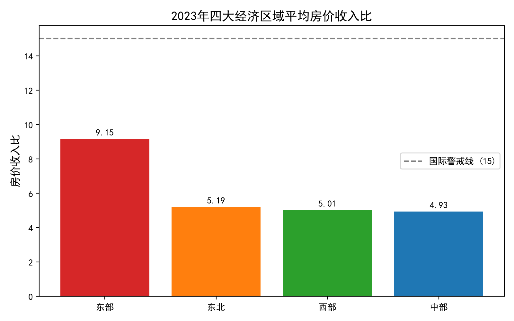
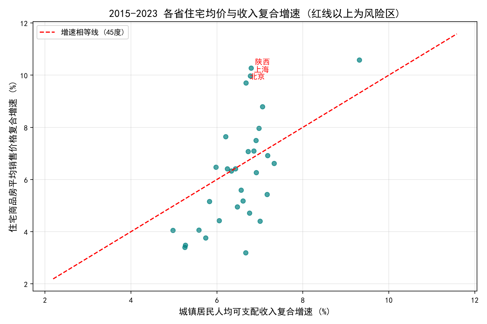

# 2015-2023 中国省级房地产购买力与区域风险分析

## 📌 项目背景
基于国家统计局 2015-2023 年面板数据，构建“房价收入比”与“增速剪刀差”指标，分析中国31个省市房地产购买力变化及区域风险差异，为金融机构房贷风控及宏观政策制定提供数据支持。

## 📊 数据来源
- 住宅商品房平均销售价格（国家统计局 2015-2023）
- 城镇居民人均可支配收入（国家统计局 2015-2023）
- *口径假设*：90平米/户，3人/户。

## 🛠️ 技术栈
- **Python** (Pandas, NumPy, Matplotlib)
- **数据处理**：宽表转长表、多表 Merge、缺失值处理、CAGR 计算

## 🚀 核心发现
1. **结构差异**：2023年东部地区平均房价收入比高达 9.15，是中部地区的 1.86 倍，远超国际警戒线。
2. **区域不平衡**：变异系数从 2015 年的 0.341 上升至 2023 年的 0.472，区域分化加剧。
3. **剪刀差风险**：识别出陕西、上海、北京 3 个高风险省市，其房价年均增速远超收入增速，存在购买力透支风险。

## 📁 目录说明
- `reports/` : 包含完整5页深度分析报告 (PDF) 与高清可视化图表。
- 省级房地产购买力与区域风险分析.py : 包含完整的数据清洗、分析与可视化代码。

## 📈 可视化展示

## 💡 业务建议
- **金融风控**：针对“增速剪刀差”高风险省份，建议金融机构实施差异化房贷审批，防范违约风险。
- **宏观政策**：高房价收入比区域应加大保障性住房供给；缺乏收入支撑但房价过热的区域需严控土地溢价。
